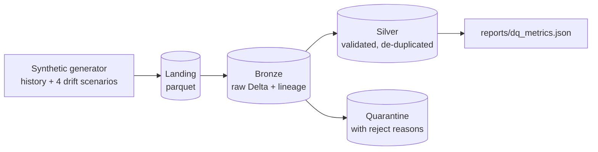

# SentinelPay: Real-Time Card Fraud Detection

> 🚧 **Work in progress.** Phase 1 of 7 (data foundation) is complete. Model training,
> streaming scoring, drift monitoring and the interactive dashboard are on the
> [roadmap](#roadmap) below.

SentinelPay is an end-to-end card fraud detection platform built the way a production
system would be. It ingests a stream of card transactions, cleans and validates them in a
Delta Lake lakehouse, and (in later phases) engineers point-in-time features with PySpark,
trains and explains a fraud model, scores transactions in real time and monitors the model
for drift.

**All data is synthetic.** A built-in deterministic generator produces realistic
cardholder behaviour plus five labelled fraud patterns, so the whole project runs with no
downloads, accounts or API keys.

---

## Run it

**Prerequisites:** Python 3.11, Java 17 or 21 (for Spark), `make`.

```bash
git clone https://github.com/hsabaghpour/realtime-card-fraud-detection.git
cd realtime-card-fraud-detection
make demo
```

`make demo` creates a virtualenv with pinned dependencies, generates ~500k transactions,
and runs them through the bronze and silver layers. It takes under a minute on a laptop.
Use `SAMPLE_SIZE=50000 make demo` for a faster run.

If Java isn't found, `make` tells you how to install it
(`brew install openjdk@17` on macOS, `apt-get install openjdk-17-jdk-headless` on Ubuntu).

| Command | What it does |
|---|---|
| `make demo` | Run the full pipeline end to end |
| `make app` | Open the dashboard at http://localhost:8501 (after `make demo`) |
| `make test` | Run the test suite with coverage |
| `make lint` / `make format` | Ruff lint and format |
| `make generate` / `bronze` / `silver` | Run a single step |
| `make clean` | Delete generated data and reports |

## What exists today (Phase 1)



* **Synthetic data generator** ([`generator.py`](src/sentinelpay/data/generator.py)):
  cardholders with home locations, spending habits and active hours; merchants across
  16 categories in 20 US cities; ~6 months of history with weekly seasonality and
  legitimate travel. It injects five fraud patterns (card testing, impossible travel,
  high-amount anomaly, night-time burst, compromised merchant) at ~0.8%, with
  **late-arriving labels** to simulate chargeback delay. It also generates a production
  month for each of four drift scenarios (`none`, `new_fraud_pattern`, `spending_shift`,
  `merchant_mix_shift`).
* **Bronze** ([`bronze.py`](src/sentinelpay/pipeline/bronze.py)): appends the raw feed to
  Delta with an enforced schema and lineage columns. Ingestion is idempotent: re-running
  never double-loads a file.
* **Silver** ([`silver.py`](src/sentinelpay/pipeline/silver.py)): validates every row,
  sends failures to a quarantine table with *all* their reject reasons, de-duplicates
  re-sent messages, and writes data-quality metrics.
* **Dashboard preview** ([`app/`](app/)): a Streamlit *Data Explorer* with four tabs.
  It shows the data's shape, walks through a real example of each fraud pattern (with a
  map for impossible travel), checks injected data problems against what silver caught,
  and compares the drift scenarios. It reads Delta tables with `deltalake`, so it needs
  no Spark or Java. The full 8-page dashboard arrives in Phase 5.

## Roadmap

| Phase | Scope | Status |
|---|---|---|
| 1. Foundation | Config, generator, bronze/silver, data quality | ✅ |
| 2. Features | Point-in-time PySpark features, feature registry, online/offline parity | ⏳ |
| 3. Model | LightGBM vs. baseline, cost-based threshold, SHAP reason codes, MLflow registry | ⏳ |
| 4. Scoring & monitoring | Batch + Structured Streaming scoring, PSI drift, delayed-label metrics | ⏳ |
| 5. GUI | 8-page Streamlit dashboard, hosted demo | ⏳ |
| 6. MLOps | Airflow DAGs, Docker Compose, CI, Databricks Asset Bundle | ⏳ |
| 7. Polish | Docs, walkthrough, optional GenAI analyst assistant | ⏳ |

## Docs

* [Design decisions](docs/design_decisions.md)
* [Data dictionary](docs/data_dictionary.md)

## License

[MIT](LICENSE)
