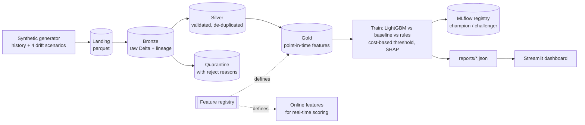

# SentinelPay: Real-Time Card Fraud Detection

> 🚧 **Work in progress.** Phases 1–3 of 7 (data foundation, features, model) are
> complete. Streaming scoring, drift monitoring, orchestration and the full dashboard are
> on the [roadmap](#roadmap) below.

SentinelPay is an end-to-end card fraud detection platform built the way a production
system would be. It ingests card transactions into a Delta Lake lakehouse, validates them,
engineers point-in-time features with PySpark, and trains an explainable LightGBM model
tracked in MLflow. The alert threshold is chosen by business cost, not a default 50%.
Coming next: real-time scoring and drift monitoring.

**All data is synthetic.** A built-in deterministic generator produces realistic
cardholder behaviour, five labelled fraud patterns, and genuine "look-alike" behaviour
(night owls, big purchases, new phones), so the project runs with no downloads,
accounts or API keys.

---

## Run it

**Prerequisites:** Python 3.11, Java 17 or 21 (for Spark), `make`.

```bash
git clone https://github.com/hsabaghpour/realtime-card-fraud-detection.git
cd realtime-card-fraud-detection
make demo   # ~1 minute: data -> bronze -> silver -> gold -> train -> promote
make app    # dashboard at http://localhost:8501
```

`make demo` creates a virtualenv with pinned dependencies and runs the whole pipeline on
~500k transactions. Use `SAMPLE_SIZE=50000 make demo` for a faster run. If Java isn't
found, `make` tells you how to install it.

| Command | What it does |
|---|---|
| `make demo` | Run the full pipeline end to end |
| `make app` | Open the dashboard (Data Explorer, Model Performance, Threshold & Trade-off) |
| `make mlflow` | Open the MLflow UI at http://localhost:5000 (runs, plots, model registry) |
| `make test` | Run the test suite with coverage |
| `make lint` / `make format` | Ruff lint and format |
| `make generate` / `bronze` / `silver` / `gold` / `train` / `promote` | Run a single step |
| `make docs` | Regenerate the feature registry doc |
| `make clean` | Delete generated data, reports and MLflow store |

## Architecture (today)



* **Data** ([`generator.py`](src/sentinelpay/data/generator.py)): customers, cards and
  merchants in 20 US cities with weekly seasonality, legitimate travel and *hard
  negatives*. Five fraud patterns at ~0.8%, **late-arriving labels** (chargeback delay),
  and a production month for each of four drift scenarios.
* **Bronze / silver** ([`pipeline/`](src/sentinelpay/pipeline/)): schema-enforced,
  idempotent ingestion; validation with a multi-reason quarantine; de-duplication;
  data-quality metrics.
* **Gold features** ([`features/`](src/sentinelpay/features/)): 26 **point-in-time**
  features (velocity, amount behaviour, impossible-travel speed, novelty, time, merchant
  risk using only labels known at the time). Defined once in the
  [feature registry](docs/features.md), with a pure-Python online version proven
  identical by a parity test.
* **Model** ([`training/`](src/sentinelpay/training/)):
  - **Time-based split** with a warm-up period.
  - **LightGBM** with a square-root class weight and Platt calibration.
  - **Baselines:** logistic regression and a hand-written rules engine.
  - **Threshold** that minimises expected business cost, chosen on validation.
  - **SHAP reason codes** in plain English.
  - **MLflow** tracking and a **champion/challenger** registry.
* **Dashboard** ([`app/`](app/)): Data Explorer, Model Performance, and an interactive
  Threshold & Trade-off page. It reads Delta tables and reports only, so it needs no
  Spark or Java.

## Results

<!-- RESULTS:START -->

_Generated by `sentinelpay readme-results` from `reports/metrics.json` (2026-11-14T22:43:32+00:00). Test window **2025-06-01 → 2025-07-01**: 88,411 transactions, 604 frauds, never seen in training. **Synthetic data**: absolute numbers are higher than on real fraud data; the comparison between approaches is the point._

| Approach | PR-AUC | Fraud caught @ 0.5% false alarms | Fraud caught | Alerts that are fraud | Alerts / day | Expected cost |
|---|---|---|---|---|---|---|
| **LightGBM (champion)** | 0.935 | 93.9% | 95.4% | 46.3% | 40.1 | $13,215 |
| Logistic regression | 0.710 | 75.7% | 90.7% | 24.2% | 73.1 | $25,325 |
| Rules engine | — | — | 43.7% | 12.8% | 66.7 | $95,345 |
| No model | — | — | 0% | — | 0 | $151,000 |

Expected cost = missed frauds × $250 + alerts × $5. The model saves **$82,130** vs. the rules engine over 31 days.

| Fraud caught by attack type | LightGBM | Logistic regression | Rules |
|---|---|---|---|
| Card testing | 97.9% | 92.3% | 22.6% |
| Impossible travel | 100.0% | 100.0% | 43.7% |
| High amount | 85.4% | 80.6% | 70.9% |
| Night burst | 100.0% | 91.4% | 100.0% |
| Compromised merchant | 88.6% | 85.7% | 0.0% |

<!-- RESULTS:END -->

## Roadmap

| Phase | Scope | Status |
|---|---|---|
| 1. Foundation | Config, generator, bronze/silver, data quality | ✅ |
| 2. Features | Point-in-time PySpark features, feature registry, online/offline parity | ✅ |
| 3. Model | LightGBM vs. baselines, cost-based threshold, SHAP reason codes, MLflow registry | ✅ |
| 4. Scoring & monitoring | Batch + Structured Streaming scoring, PSI drift, delayed-label metrics | ⏳ |
| 5. GUI | Full 8-page Streamlit dashboard, hosted demo | ⏳ |
| 6. MLOps | Airflow DAGs, Docker Compose, CI, Databricks Asset Bundle | ⏳ |
| 7. Polish | Docs, walkthrough, optional GenAI analyst assistant | ⏳ |

## Docs

* [Design decisions](docs/design_decisions.md): the *why* behind every choice
* [Feature registry](docs/features.md)
* [Data dictionary](docs/data_dictionary.md)

## License

[MIT](LICENSE)
